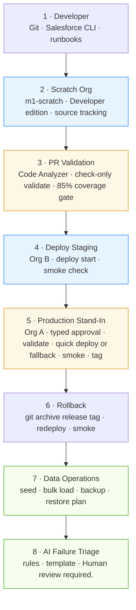
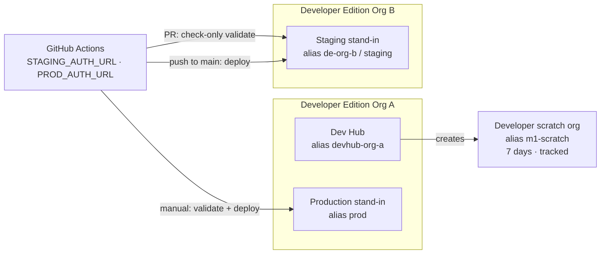
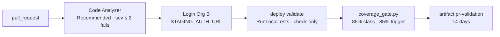
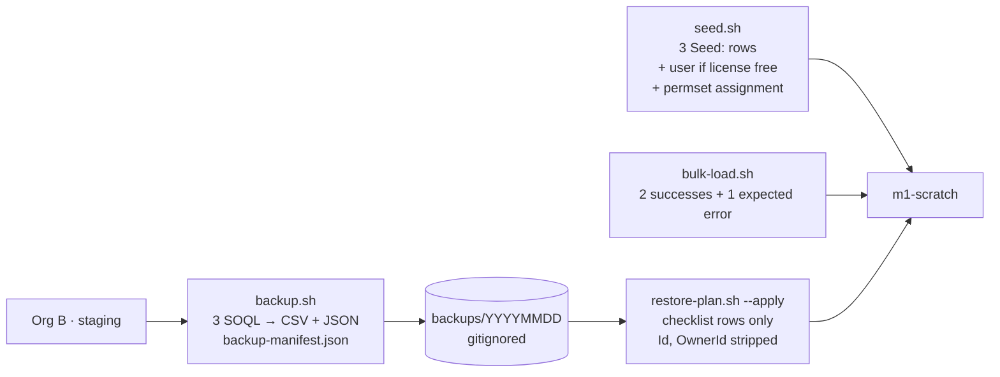
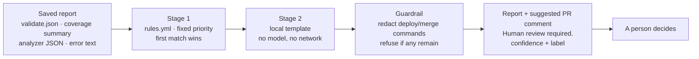

# Architecture

This document covers the layers of the Salesforce DevOps Pipeline and what each one does. It also lists what each layer refuses to do and where its evidence lives. Implementation detail is in [TECHNICAL_DESIGN.md](TECHNICAL_DESIGN.md).

> **Evidence boundary.** The layers below exist as files in the repository and are validated locally. None of them has been run against a Salesforce org from the authoring workspace. All orgs are Developer Edition. There is no sandbox, Enterprise org, or production tenant.

---

## Layered view

The layers are listed in the order a change and its operational follow-up are usually discussed. At run time:

- **Layers 1 → 5** are one sequence for each change.
- **Layer 6** runs only when a release must be undone.
- **Layer 7** is a separate operator routine on its own schedule. No workflow runs it.
- **Layer 8** is a side channel. It reads reports that layers 3 and 5 already saved, and it can't change anything.

## Org topology

| Org | Edition | Source tracking | Receives | Auth |
|---|---|:-:|---|---|
| Org A | Developer Edition | No | Scratch org creation (as Dev Hub). Production releases and rollbacks (as `prod`). | Local web login. `PROD_AUTH_URL` secret in CI. |
| Org B | Developer Edition | No | Check-only validations on PRs. Deploys on push to `main`. Nightly backups. | Local web login. `STAGING_AUTH_URL` secret in CI. |
| Scratch org | Developer (scratch) | Yes | Development, retrieval, Apex tests, seed and bulk loads, restore drills | CLI-managed, created from Org A |

One known trade-off: **Org A is both the Dev Hub and the production stand-in.** A release writes metadata into the Dev Hub org, so production releases aren't isolated from scratch-org administration. The project accepts this because it has only two Developer Edition orgs, and the docs state it.

---

## Layer 1 · Developer

**Purpose.** This is the human entry point. Git is the source of truth, and the Salesforce CLI is the only tool that talks to orgs.

| Element | Detail |
|---|---|
| Source of truth | `force-app/` in Git, source format, API 68.0, no namespace |
| Tooling | `sf` CLI, Git, Bash, Python 3.11+, Node 20+ |
| Guidance | `runbooks/starting-new-development.md` (checklist) and `docs/RUNBOOK.md` (expected results, 8 recovery procedures) |
| Secrets hygiene | `.sf/`, `.sfdx/`, `.artifacts/`, report outputs, and `backups/` are gitignored. The repository holds no usernames, passwords, or tokens. |
| Deploy hygiene | `.forceignore` excludes `docs/`, `runbooks/`, `tests/`, and Node tooling from any deploy |

**Won't do:** commit CLI auth state, or treat the home directory as the repository.

## Layer 2 · Scratch Org

**Purpose.** A disposable, source-tracked environment where declarative and code changes are made and captured.

| Element | Detail |
|---|---|
| Definition | `config/project-scratch-def.json`: edition `Developer`, Lightning Experience on, `hasSampleData: false`, `EnableSetPasswordInApi` |
| Lifetime | 7 days by runbook convention. The platform allows 1 to 30. |
| Quota gate | `sf limits api display` must show `ActiveScratchOrgs` (max 3) and `DailyScratchOrgs` (max 6 per rolling 24 hours) with room left |
| Change capture | Setup change → `sf project retrieve preview` → `retrieve start` → `git commit` |
| Tests | `RunLocalTests` with coverage. The documented expectation is 7 tests passing and 100% coverage on the service and trigger. |
| Teardown | `sf org delete scratch` returns the active slot. The daily create still counts. |

**Why scratch orgs:** Developer Edition orgs can't be source-tracked and can't create sandboxes. The scratch org is the only tracked environment available.

**Won't do:** retrieve from Org A or Org B as if they were tracked, or create scratch orgs "to make room" for a release.

## Layer 3 · PR Validation

**Purpose.** Stop bad metadata before it can reach any long-lived org. This layer never saves anything.

| Gate | Fails on | Why this order |
|---|---|---|
| Code Analyzer | Severity 1 (Critical) or 2 (High) | Cheapest check. Needs no org and no API calls. |
| Check-only validation | Compile errors, component errors, any Apex test failure | Proves the payload deploys and the tests pass against a real org, without saving |
| Coverage gate | Any non-test class or trigger under 85%, a missing coverage row, or malformed JSON | Org B doesn't enforce the 75% production rule, so the repository enforces 85% itself |

The coverage gate step runs `if: always()` whenever `validate.json` exists, so a failed validation still produces a readable summary.

**Won't do:** deploy, quick-deploy, or reuse the validation job ID. Fork PRs fail at login because GitHub doesn't pass secrets to forks.

## Layer 4 · Deploy Staging

**Purpose.** Keep a long-lived org in step with `main`, so the production release follows something that has actually been deployed.

| Element | Detail |
|---|---|
| Trigger | Push to `main`. The merge is the approval for Org B. |
| Command | `sf project deploy start --source-dir force-app --target-org staging --test-level RunLocalTests --wait 30` |
| Verification | `scripts/smoke_check.sh staging`: object, permission set, LWC, flow, `RunLocalTests` |
| Concurrency | Group `deploy-staging`, no cancel-in-progress |

**Constraint:** `RunLocalTests` runs every local test in Org B, and Org B can't be refreshed. Unrelated tests left in the org will fail staging.

**Won't do:** tag a release. Staging deploys aren't release records.

## Layer 5 · Production Stand-In

**Purpose.** A controlled, recorded release to Org A that behaves like a production release path wherever Developer Edition allows it, and records the difference where it doesn't.

```mermaid
sequenceDiagram
    autonumber
    actor Op as Operator
    participant GH as Deploy Production
    participant A as Org A (prod)
    Op->>GH: workflow_dispatch, confirm = "deploy"
    GH->>GH: reject any other word
    GH->>A: login with PROD_AUTH_URL
    GH->>A: deploy validate (check-only, RunLocalTests)
    GH->>GH: coverage_gate.py (85%)
    GH->>GH: parse_job_id.py (0Af… only if Succeeded)
    GH->>A: deploy quick --job-id
    alt quick deploy succeeds
        GH->>GH: record succeeded
    else refusal matches a known "production only" phrase
        GH->>A: deploy start (RunLocalTests again)
        GH->>GH: record unsupported + reason
    else any other error
        GH->>GH: record failed, stop (no fallback)
    end
    GH->>A: smoke_check.sh prod
    GH->>GH: release-YYYYMMDD-HHMM (fail if it exists)
    GH->>GH: upload production-release artifact
```

| Control | Effect |
|---|---|
| Typed approval | Any value other than `deploy` stops the job before login |
| Validate first | A failed validation or coverage gate means quick deploy never starts |
| Job-ID check | `parse_job_id.py` accepts only a `0Af…` ID from a validation whose status is Succeeded |
| Narrow fallback | Only a recognised edition refusal triggers a normal deploy. An expired job, an auth error, or another CLI error stops the release. |
| Release record | `reports/quick-deploy.json` captures the outcome, the reason, and the CLI output, and is uploaded as an artifact |
| Tag after smoke | The tag exists only if smoke passed. An existing tag is never moved. |

**Expected Developer Edition result:** `outcome: unsupported`, `fallbackUsed: true`. That is recorded, not treated as a failure.

## Layer 6 · Rollback

**Purpose.** Return an org's metadata to a known release quickly, without pretending to restore data.

| Step | Detail |
|---|---|
| Select | The latest `release-*` tag (zero-padded names sort by time), or `--tag` |
| Guard | No tag found → exit 1. Wrong format → exit 2. Tag not in clone → exit 1. |
| Extract | `git archive <tag>` into a temp directory, so the working tree is untouched |
| Deploy | `sf project deploy start --source-dir force-app --test-level RunLocalTests` |
| Delete | Only if *that tag's* `manifest/destructiveChangesPost.xml` lists members. The committed file lists none. |
| Verify | `scripts/smoke_check.sh <alias>` |
| Preview | `--dry-run` prints the plan and calls nothing |

**Won't do:** restore, delete, or reshape records. It prints `data: metadata-only rollback; org records are not restored`. A field removed by a destructive change loses its values, and Developer Edition has no sandbox copy to recover them from.

## Layer 7 · Data Operations

**Purpose.** Give operators safe, repeatable data handling for test environments, and a restore *plan* that respects what can't be restored.

| Rule | Reason |
|---|---|
| Synthetic data only | No customer data in the repository. Names start `Seed:` or `Bulk:`. |
| Backups are local and gitignored | A user export contains usernames and emails |
| One folder per UTC day, never overwritten without `--force` | Keeps a clean history (7 daily folders by runbook) |
| Users aren't restored | Licenses are scarce (typically 2), usernames are globally unique, and passwords and sessions aren't exportable |
| IDs and owners are stripped | IDs belong to one org. The importing user becomes the owner. |
| Restore is explicit | Without `--apply` the script only prints. With it, both `--backup` and `--target-org` are required. |

**Won't do:** deploy metadata, run from a workflow, or deduplicate a second `--apply`. Re-applying inserts duplicates, which the runbook documents.

## Layer 8 · AI Failure Triage

**Purpose.** Shorten the time from "the check is red" to "a person knows what to look at", without giving software any authority to act.

| Property | Detail |
|---|---|
| Categories | 8, in priority order: Authentication, Permission, Code Analyzer (sev 1–2), Apex Test, Coverage, Metadata Conflict, Missing Component, Unknown |
| Precedence logic | Auth and permission errors outrank test noise. A test failure outranks low coverage on the same run. |
| Confidence | 0.88 to 0.97 for known categories (high). Unknown is 0.34 (low). |
| Evaluation | 15 fixtures, 15 correct, 2 expected Unknown, accuracy 1.0 |
| Dependencies | Python standard library only. It includes its own YAML-subset parser. |
| Integration | No workflow runs it. It reads files the workflows already upload as artifacts. |

**Won't do:** call Salesforce, call a model, post to GitHub, deploy, roll back, merge, approve, or change metadata. It never suggests `sf project deploy start`, `sf project deploy quick`, or `git merge`.

---

## Cross-cutting concerns

| Concern | Approach |
|---|---|
| **Security** | Auth URLs only in GitHub secrets. A `umask 077` temp file is deleted right after login. Workflow `permissions` are `contents: read`, except `contents: write` on the production job, which pushes the tag. |
| **Auditability** | Artifacts kept for 14 days. `quick-deploy.json` records release decisions. Annotated tags. Coverage summaries. Backup manifests. |
| **Idempotency and safety** | Tags are never moved. Backups are never overwritten by default. The coverage gate and job parser fail closed. Concurrency groups queue deploys. |
| **Limits awareness** | 15,000 API requests per day per Developer Edition org, 3 and 6 scratch quotas, 5 MB data storage. `REQUEST_LIMIT_EXCEEDED` is treated as a limit, not a defect. |
| **Testability** | Every decision script exposes pure functions. 83 Python tests and 8 Node tests run without Salesforce. |
| **Documentation** | Each layer has a runbook with expected results, negative tests, and recovery steps |

## What the architecture deliberately doesn't include

| Absent | Reason |
|---|---|
| Sandboxes or a sandbox pipeline | Developer Edition orgs can't create them |
| A real production org | None available. Org A is a labelled stand-in. |
| A Lifecycle Center or Flosum integration | Studied only. Neither was enabled or licensed. |
| A triage workflow or bot | Triage is advisory and deliberately has no write path |
| Scheduled data jobs in CI | Data work is an operator routine. The workflows stay metadata workflows. |
