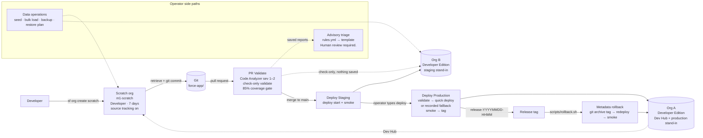

<div align="center">

# Salesforce DevOps Pipeline

**Salesforce technical operations, release engineering, and advisory deploy-failure triage, built for Developer Edition orgs.**


</div>

> **Evidence boundary.** Every workflow, script, fixture, and runbook described here is in this repository. Local validation is 83 Python tests and 8 Node foundation tests, and none of them call Salesforce. From the machine that authored the repository, the Salesforce CLI was not installed, no scratch org was created, and no deploy, validation, seed, backup, rollback, release tag, or language-model call was executed. A live run needs the two GitHub secrets and one run of each workflow. The orgs in the design are Developer Edition orgs. There is no Enterprise org, no sandbox, no production tenant, and no Flosum tenant.

## Contents

[Project Summary](#project-summary) · [Project Purpose](#project-purpose) · [Milestones](#current-milestone-status) · [Architecture](#architecture) · [Salesforce DX](#salesforce-dx) · [Scratch Org Workflow](#scratch-org-workflow) · [PR Validation](#pr-validation) · [Coverage Gates](#coverage-gates) · [Deployments](#deployments) · [Release Tags](#release-tags) · [Rollback](#rollback) · [Data Operations](#data-operations) · [Release Tool Comparison](#release-tool-comparison) · [AI Failure Triage](#ai-deploy-failure-triage) · [Project Metrics](#project-metrics) · [Repository Structure](#repository-structure) · [Installation](#installation) · [Execution](#execution) · [Demo Guide](#demo-guide) · [Roadmap](#roadmap) · [Developer Edition Limitations](#developer-edition-constraints) · [Documentation](#documentation) · [License](#license)

---

## Project Summary

This repository is one release path for a small Salesforce application. Work starts in a Developer scratch org. Each pull request is gated by Code Analyzer, a check-only validation, and an 85% Apex coverage rule. A merge deploys to a staging stand-in. A manual, typed approval releases to a production stand-in. The release is tagged and can be rolled back by tag. Separately, the operator has scripts for synthetic data loads, backups, and a restore plan. When a check fails, a rules-based triage tool reads the saved report and drafts advice for a person.

The payload is a deliberately small **Release Checklist Item** application: one custom object, four fields, an Apex service, a trigger, a test class, a record-triggered flow, a Lightning web component, and a permission set. The application isn't the point. It gives the pipeline real metadata to validate, deploy, smoke-check, and roll back.

| | |
|---|---|
| **Built for** | Salesforce technical operations, DevOps, release engineering, and application support roles |
| **Org model** | Developer Edition Org A (Dev Hub and production stand-in), Developer Edition Org B (staging stand-in), and a Developer scratch org |
| **Toolchain** | Salesforce CLI (`sf`), Salesforce Code Analyzer, GitHub Actions, Python 3.11+, Bash, Node.js 20+ |
| **Status** | Milestones M1–M6 complete as repository deliverables. Locally validated. Not yet run against an org. |

## Project Purpose

Give one operator a repeatable, documented way to:

- authenticate Developer Edition Org A and use it as a Dev Hub
- create a short-lived Developer scratch org from `config/project-scratch-def.json`
- deploy the sample metadata, change it in Setup, and retrieve the change with source tracking
- run local Apex tests with `RunLocalTests` and read the coverage report
- block a pull request on Critical or High Code Analyzer findings, a failed check-only validation, or Apex coverage under 85%
- deploy to Org B after a merge, and to Org A only after a typed manual approval
- tag each production stand-in release and roll metadata back to a tag
- seed synthetic rows, export CSV and JSON backups, and plan a data restore that doesn't insert users
- classify a saved failure report and draft a pull-request comment that a person reviews

## Current Milestone Status

| Milestone | Scope | State |
|---|---|---|
| **M1** | DX project, Dev Hub, scratch orgs, source tracking, Apex tests, runbooks | Complete |
| **M2** | Pull-request validation: Code Analyzer, check-only validate, 85% coverage gate | Complete |
| **M3** | Staging deploy, production stand-in deploy, quick-deploy fallback, release tags, rollback | Complete |
| **M4** | Synthetic seed, bulk load, CSV and JSON backups, backup catalog, restore plan | Complete |
| **M5** | Studied comparison of the CLI path with Salesforce Lifecycle Center and Flosum | Complete (documentation) |
| **M6** | Advisory deploy-failure triage over saved reports | Complete |

"Complete" means the files exist and pass local validation. None of the milestones has been exercised against a Salesforce org.

## Architecture



| Alias | Org | Role |
|---|---|---|
| `devhub-org-a` | Developer Edition Org A | Local Dev Hub alias. Creates scratch orgs (3 active, 6 per rolling 24 hours). |
| `prod` | Developer Edition Org A | Workflow alias for the **production stand-in**. Receives metadata only from the manual workflow or a rollback. |
| `de-org-b` / `staging` | Developer Edition Org B | Local alias and workflow alias for the **staging stand-in**. Receives check-only validations on pull requests and a deploy on every push to `main`. |
| `m1-scratch` | Developer scratch org | The only source-tracked org. Development, retrieval, Apex tests, seeding, and restore drills. |

The deep dive is in [ARCHITECTURE.md](ARCHITECTURE.md) and [TECHNICAL_DESIGN.md](TECHNICAL_DESIGN.md).

## Salesforce DX

| Setting | Value | Source |
|---|---|---|
| Project name | `sf-devops-pipeline` | `sfdx-project.json` |
| Package directory | `force-app` (default) | `sfdx-project.json` |
| Source API version | `68.0` | `sfdx-project.json`, `manifest/package.xml`, every `-meta.xml` |
| Namespace | none | `sfdx-project.json` |
| Login host | `https://login.salesforce.com` (the Developer Edition login host) | `sfdx-project.json` |
| Format | Source format. No unlocked or managed packages. | `force-app/` |

The sample application under `force-app/main/default/`:

| Component | API name | Behaviour |
|---|---|---|
| Custom object | `Release_Checklist_Item__c` | Read/write sharing model |
| Fields | `Status__c` (restricted picklist: Draft, Ready, Complete), `Sequence__c`, `Details__c`, `Ready_For_Review__c` | Small, stable field set |
| Apex service | `ReleaseChecklistItemService` | `with sharing`. Fills a blank status with `Draft` and a blank sequence with `100`. |
| Trigger | `ReleaseChecklistItemTrigger` | `before insert, before update`, calls the service |
| Test class | `ReleaseChecklistItemServiceTest` | 7 test methods, including a 200-record bulk insert. No `SeeAllData`. |
| Flow | `Stamp_Ready_For_Review` | Record-triggered before-save flow. Sets the Ready for Review flag when Status is Ready and clears it when Status leaves Ready. |
| LWC | `checklistItemBadge` | App Builder component for app, record, and home pages |
| Permission set | `Release_Checklist_Access` | Object and field access for the deployed fields |

`.forceignore` keeps `docs/`, `runbooks/`, `tests/`, and Node tooling out of any deploy.

## Scratch Org Workflow

The scratch definition requests edition `Developer`, Lightning Experience, no sample data, and `EnableSetPasswordInApi`. The runbook creates orgs for 7 days. The platform maximum is 30.

```bash
sf org login web --alias devhub-org-a --instance-url https://login.salesforce.com --set-default-dev-hub
sf limits api display --target-org devhub-org-a          # ActiveScratchOrgs max 3, DailyScratchOrgs max 6
sf org create scratch --definition-file config/project-scratch-def.json --alias m1-scratch --duration-days 7 --set-default --target-dev-hub devhub-org-a
sf project deploy start --source-dir force-app --target-org m1-scratch --wait 10
sf org assign permset --name Release_Checklist_Access --target-org m1-scratch
# make a Setup change, e.g. add checkbox Needs_Follow_Up__c, then:
sf project retrieve preview --target-org m1-scratch
sf project retrieve start --target-org m1-scratch
sf apex run test --test-level RunLocalTests --code-coverage --result-format human --wait 20 --target-org m1-scratch
git add force-app && git commit -m "Record the scratch org metadata change."
sf org delete scratch --target-org m1-scratch --no-prompt    # returns the active slot, not the daily create
```

The expected test result is documented as 7 tests passing, with `ReleaseChecklistItemService` and `ReleaseChecklistItemTrigger` at 100% coverage. That is the documented expectation, not a recorded org run. Source tracking works only on the scratch org. Org A and Org B are Developer Edition orgs and aren't tracked. Recovery procedures R1–R8 are in [docs/RUNBOOK.md](docs/RUNBOOK.md).

## PR Validation

`.github/workflows/pr-validate.yml` runs on every `pull_request`. It never deploys.

| Step | What it does | Fails the PR when |
|---|---|---|
| Java, Node, CLI setup | Temurin 17 (for PMD), Node 20, `@salesforce/cli@latest` | Setup fails |
| Code Analyzer | `sf code-analyzer run --workspace force-app --rule-selector Recommended --severity-threshold 2` | A severity 1 (Critical) or 2 (High) violation is found |
| Org Login | Writes `STAGING_AUTH_URL` to a `umask 077` temp file, logs in as `staging`, deletes the file | The secret is empty (also the case for fork PRs) |
| Deploy Validation | `sf project deploy validate --source-dir force-app --target-org staging --test-level RunLocalTests --wait 30 --json` | Validation or any Apex test fails |
| Coverage Gate | `scripts/coverage_gate.py reports/validate.json`. Runs `if: always()` whenever the JSON exists. | Any non-test class or trigger is under 85%, or the JSON is unusable |
| Artifact Upload | `pr-validation`: `validate.json`, `code-analyzer.html`, `coverage-summary.md`, kept for 14 days | — |

Details and expected negative-test outputs are in [docs/pr_validation.md](docs/pr_validation.md).

## Coverage Gates

The platform's 75% rule applies to production deployments and isn't enforced on Developer Edition Org B. The repository sets its own stricter rule in `scripts/coverage_gate.py`.

| Rule | Value |
|---|---|
| Class threshold | 85% for each non-test class |
| Trigger threshold | 85% for each trigger |
| Excluded | Class names ending in `Test` or `_Test` |
| Arithmetic | `(numLocations − numLocationsNotCovered) / numLocations`, `Decimal`, rounded half up to 2 places. 85.00% passes and 84.99% fails. |
| Also fails | A failed validation status, any test failure, any component failure, or a deployed class or trigger with no coverage row |
| Exit codes | `0` pass · `1` gate failed · `2` malformed or unreadable input |
| Output | `reports/coverage-summary.md` with a per-row table and the aggregate class and trigger percentages |

Measured locally against the seven committed fixtures:

| Fixture | Exit | Result |
|---|:-:|---|
| `validate-pass.json` | 0 | Pass |
| `validate-exact-threshold.json` | 0 | Pass at exactly 85.00% |
| `validate-low-coverage.json` | 1 | Class at 80.00%, trigger at 25.00% |
| `validate-missing-coverage.json` | 1 | Deployed class with no coverage entry |
| `validate-empty-coverage.json` | 1 | `codeCoverage` is empty |
| `validate-test-failure.json` | 1 | Validation status is Failed |
| `validate-malformed.json` | 2 | Malformed JSON |

## Deployments

| Workflow | Trigger | Target | What runs |
|---|---|---|---|
| `deploy-staging.yml` | Push to `main` | Org B (`staging`) | `sf project deploy start --test-level RunLocalTests`, then `scripts/smoke_check.sh staging` |
| `deploy-prod.yml` | `workflow_dispatch` only, input `confirm` must be `deploy` | Org A (`prod`) | Check-only validate → coverage gate → capture the `0Af…` job ID → quick deploy or recorded fallback → smoke → tag → artifact |

Both workflows use a `concurrency` group with `cancel-in-progress: false`, so a second run queues instead of cancelling one already deploying.

**Quick deploy on a Developer Edition stand-in.** Salesforce documents quick deploy as a production-org operation. `scripts/production_deploy.sh` tries `sf project deploy quick --job-id <id>`. `scripts/quick_deploy_decision.py` then classifies the result:

| Outcome | Meaning | Action |
|---|---|---|
| `succeeded` | Quick deploy exited 0 | Record and continue |
| `unsupported` | The CLI text matches one of 9 known "production only" refusal phrases | Deploy with `sf project deploy start` (tests run again) and record why |
| `failed` | Any other error (expired job ID, auth, CLI error) | Stop. **No fallback deploy.** |

Every attempt is written to `reports/quick-deploy.json` with the job ID, `quickDeploySupported`, `fallbackUsed`, `outcome`, `reason`, the command used, and the parsed CLI output. On Org A the expected outcome is `unsupported`.

**Smoke checks** (`scripts/smoke_check.sh <alias>`) run after every staging deploy, production deploy, and rollback. They check five things: the custom object describes, the permission set, LWC, and flow are listed in metadata, and `RunLocalTests` passes.

The release runbook is [docs/deployment_runbook.md](docs/deployment_runbook.md).

## Release Tags

| Rule | Value |
|---|---|
| Format | `release-YYYYMMDD-HHMM` (for example `release-20261109-1240`) |
| Clock | UTC, from `scripts/release_tag.py`, which refuses a timezone-naive time |
| Type | Annotated tag, pushed as `refs/tags/<tag>` |
| When | Only after the production smoke check passes |
| Collision | If the tag already exists, the job fails rather than moving it |
| Scope | Production stand-in only. Staging deploys aren't tagged. |

Zero-padded fields make lexicographic order match time order, which is how `rollback.sh` finds the latest release.

## Rollback

`scripts/rollback.sh` restores **metadata** from a release tag. It doesn't restore records.

```text
latest release-* tag, or --tag
  → validate the tag name and that it exists
  → git archive <tag> into a temp directory
  → sf project deploy start --source-dir force-app --test-level RunLocalTests
  → apply manifest/destructiveChangesPost.xml only if that tag's copy lists <members>
  → scripts/smoke_check.sh <alias>
```

- The default target is `prod`. Pass `--target-org staging` for Org B.
- `--dry-run` prints the plan and doesn't call Salesforce.
- It refuses to run without a tag (exit 1) or with a tag that doesn't match the format (exit 2).
- The committed destructive manifest lists no members, so a rollback of the current sample deletes nothing.
- It prints `data: metadata-only rollback; org records are not restored` before deploying. Records are reloaded only through the data restore plan.

## Data Operations

Four operator scripts work on synthetic rows only. They never deploy metadata, and no GitHub workflow runs them.

| Script | Default target | What it does |
|---|---|---|
| `scripts/seed.sh` | `m1-scratch` | Bulk-imports 3 `Seed:` checklist rows and verifies at least 3 exist. Imports 1 synthetic user only if a Salesforce license is free, then assigns `Release_Checklist_Access`. Warns if pointed at the Dev Hub. |
| `scripts/bulk-load.sh` | `m1-scratch` | Loads 3 `Bulk:` rows, 2 of which succeed. The `NotAStatus` row is an expected restricted-picklist failure. `--preflight` writes success and error CSVs locally without Salesforce. |
| `scripts/backup.sh` | `staging` | Runs 3 committed SOQL queries (checklist items, active users, non-profile permission set assignments) into CSV and JSON under `backups/YYYYMMDD/`, plus `backup-manifest.json`. Refuses to overwrite a day's folder without `--force`. |
| `scripts/restore-plan.sh` | none | Prints the restore order. With `--apply --backup <dir> --target-org <alias>` it re-inserts **checklist rows only**, after stripping `Id`, `OwnerId`, and other system columns. It never inserts users. |

`backups/` is gitignored because a real export contains usernames. Running `--apply` twice duplicates rows, which is documented as a known risk. The procedures and nightly checklist are in [docs/data_operations.md](docs/data_operations.md).

## Release Tool Comparison

| Concern | Salesforce CLI (this repo) | Lifecycle Center | Flosum |
|---|---|---|---|
| Evidence | **Implemented** | **Studied** | **Studied** |
| Source of truth | Git | Git, with Salesforce-managed work-item branches | A Flosum branch. Vendor-stated: Git is optional. |
| Environments this project can use | Scratch org, Org B, Org A | Trailhead's declarative path uses a sandbox, which this project can't create | Connected customer orgs. None were connected. |
| Pull-request gate | Code Analyzer sev 1–2, check-only validate, 85% coverage | Testing gates reported by a secondary 2026 summary, not re-proven here | Pipeline validation and test steps |
| Rollback | Redeploy a `release-*` tag. Metadata only. | No one-click undo found in the pages read | Vendor-stated one-click rollback. Not executed. |
| Data | Synthetic seed, 3-query backup, checklist-only restore | Configuration data can travel with metadata | Backup & Archive and Data Migrator are separate modules |
| Cost here | CLI and GitHub Actions only | Not enabled | No tenant, no subscription |

Lifecycle Center was not turned on, and no paid Flosum environment was opened. The full table and the selection guide are in [docs/release-comparison.md](docs/release-comparison.md), [docs/tool-selection-guide.md](docs/tool-selection-guide.md), [docs/lifecycle-center-notes.md](docs/lifecycle-center-notes.md), and [docs/flosum-notes.md](docs/flosum-notes.md).

## AI Deploy-Failure Triage

`triage/triage.py` reads a report a validation run already saved and classifies the failure. It produces advice for a person. It doesn't log in, deploy, roll back, merge, approve, change metadata, post comments, or open a network connection.

- **Stage 1, rules.** `triage/rules.yml` maps substrings, regular expressions, and structured JSON fields to a category. It reads `runTestResult.failures`, `codeCoverage`, `componentFailures`, and Code Analyzer `violations`. The first match in a fixed priority order wins.
- **Stage 2, explanation.** A local template turns the match into a short paragraph. No model client, API key, or network call exists in the repository. Every report says *"This explanation is rule-based, not a live model call."*
- **Inputs.** `validate.json`, a coverage summary in markdown, coverage JSON, Apex failure lists, deployment component errors, or Code Analyzer JSON.
- **Guardrail.** If an echoed error contains `sf project deploy start`, `sf project deploy quick`, or `git merge`, the text is redacted. A report that still contains one is refused.
- **Dependencies.** None. The engine parses its YAML subset itself, so it runs on the Python standard library.

## Failure Classification

| Order | Category | Typical evidence | Confidence |
|:-:|---|---|:-:|
| 1 | Authentication Failure | `INVALID_SESSION_ID`, `invalid_grant`, expired token | 0.97 |
| 2 | Permission Problem | `INSUFFICIENT_ACCESS`, insufficient access rights | 0.94 |
| 3 | Code Analyzer Violation | Severity 1 (Critical) or 2 (High). Severity 3+ does not match. | 0.93 |
| 4 | Apex Test Failure | `System.AssertException`, a `failures` entry, `numFailures` ≥ 1 | 0.95 |
| 5 | Coverage Failure | Tests passed and a non-test class or trigger is under 85% | 0.92 |
| 6 | Metadata Conflict | `entity is already a member`, `DUPLICATE_VALUE` | 0.90 |
| 7 | Missing Component | `no such column`, `Dependent class is invalid`, `does not exist` | 0.88 |
| 8 | Unknown | Nothing above matched | 0.34 |

Authentication and permission errors outrank test and coverage noise, because a deploy that never authenticated didn't reach those gates. A test failure outranks low coverage on the same run. Evaluated against **15 committed fixtures: 15 correct, 0 incorrect, 2 expected Unknown, accuracy 1.0.** Those are local fixtures, not production statistics. See [docs/ai_triage_evaluation.md](docs/ai_triage_evaluation.md).

## Human Review Gate

Every report and every suggested pull-request comment contains the exact sentence:

> Human review required.

Each report also carries a confidence value and label: high at 0.80 or above, medium from 0.50 to 0.79, low below 0.50. Confidence isn't approval. The suggested comment is text in the report. The program doesn't call GitHub and doesn't post it. The suggested next step tells a person to read a file, fix a test, refresh a login, or re-run a check-only validation. It never tells them to deploy or merge.

Real output for `triage/eval/coverage-82-tests-pass.json`:

```text
Human review required.

Failure Category: Coverage Failure
Confidence: 0.92 (high)
Likely Cause: Apex tests passed, and coverage for ReleaseChecklistItemService fell below 85% (reported 82.00%).
Suggested Next Step: Read the coverage rows for ReleaseChecklistItemService, add or extend an Apex test that executes the uncovered lines, and re-run check-only validation locally.
Reference Artifact: triage/eval/coverage-82-tests-pass.json#result.details.runTestResult.codeCoverage[ReleaseChecklistItemService]

Validation failed because coverage for ReleaseChecklistItemService fell below 85% (reported 82.00%). Review the uncovered lines in that class and extend the Apex tests before the next check-only validation.

This explanation is rule-based, not a live model call.
This note is advisory only. A person must review it. The program does not post this comment.
```

## Project Metrics

Every figure below was counted from the repository or produced by running its local checks. None is a production release statistic.

| Area | Metric |
|---|---|
| Milestones | 6 (M1–M6) |
| GitHub Actions workflows | 3: `pr-validate.yml`, `deploy-staging.yml`, `deploy-prod.yml` |
| Operational scripts | 12 (7 Bash, 5 Python) |
| Local tests | **83 Python** (23 triage, 11 coverage gate, 23 deployment, 26 data operations) + **8 Node** foundation tests |
| Apex test methods | 7, including a 200-record bulk insert |
| Coverage threshold | 85% per class and per trigger (platform production minimum: 75%) |
| Coverage-gate fixtures | 7 |
| Triage | 8 categories · 15 fixtures · 15/15 correct · 2 expected Unknown · accuracy 1.0 |
| Smoke checks per deploy | 5 |
| Backup catalog | 3 SOQL queries → 6 export files + 1 manifest per day |
| Synthetic data | 3 seed rows, 3 bulk rows (1 intentional failure), 1 synthetic user |
| Quick-deploy refusal phrases recognized | 9 |
| Documentation | 19 runbooks and reference docs (~25,500 words) |
| Code size (non-blank lines) | ~960 Python scripts · ~710 Bash · ~1,100 triage engine and rules · ~1,460 tests · ~230 workflow YAML · ~140 Apex |

## Repository Structure

```text
sf-devops-pipeline/
├── .github/workflows/        pr-validate.yml · deploy-staging.yml · deploy-prod.yml
├── config/                   project-scratch-def.json (edition Developer)
├── force-app/main/default/   object + 4 fields · Apex service + test · trigger · flow · LWC · permission set
├── manifest/                 package.xml · destructiveChangesPost.xml (no members)
├── scripts/                  coverage gate · job id · quick-deploy decision · production deploy · smoke ·
│                             release tag · rollback · seed · bulk load · backup · restore plan · data_ops
├── triage/                   triage.py · rules.yml · eval/ (15 fixtures + manifest.json)
├── backup-queries/           Release_Checklist_Item.soql · User.soql · PermissionSetAssignment.soql
├── data/                     seed/ and bulk/ synthetic CSVs
├── backups/ · reports/       gitignored output (README only is tracked)
├── docs/                     17 runbooks and reference docs
├── runbooks/                 starting-new-development.md
├── tests/                    4 Python suites · 1 Node suite · fixtures/ (7 validate JSONs)
├── sfdx-project.json
└── *.md                      README and the portfolio documents listed under Documentation
```

## Installation

| Requirement | Needed for |
|---|---|
| Git and Bash | Everything. On Windows, use Git Bash or WSL for the `.sh` scripts. |
| Python 3.11+ | Coverage gate, deployment helpers, data helpers, triage, and the Python tests. Standard library only, with no `pip install`. |
| Node.js 20+ | The Node foundation tests and the Salesforce CLI. No `npm install`. |
| Windows PowerShell | Node foundation test 4 parses the metadata XML with `powershell`. On macOS or Linux that one test fails with `spawnSync powershell ENOENT`. |
| Salesforce CLI (`sf`) | Every org operation: `npm install --global @salesforce/cli` |
| Java 11+ (17 in CI) | Running Salesforce Code Analyzer locally (`sf plugins install code-analyzer`) |
| Developer Edition Org A | System Administrator login with Dev Hub enabled (Setup → Dev Hub) |
| Developer Edition Org B | The staging stand-in |

For CI, add two repository secrets under Settings → Secrets and variables → Actions:

```bash
sf org login web --alias staging --instance-url https://login.salesforce.com     # Org B
sf org display --target-org staging --verbose --json                              # copy sfdxAuthUrl → STAGING_AUTH_URL
sf org login web --alias prod --instance-url https://login.salesforce.com        # Org A
sf org display --target-org prod --verbose --json                                 # copy sfdxAuthUrl → PROD_AUTH_URL
```

Never commit that JSON. `--verbose` prints a refresh token. Secrets aren't passed to pull requests from forks, so open PRs from a branch in this repository.

## Execution

**Validate the repository locally** (no Salesforce calls):

```bash
python -m unittest tests.test_triage tests.test_coverage_gate tests.test_deployment tests.test_data_operations   # Ran 83 tests … OK
node --test tests/m1-foundation.test.js                                                                          # 8 tests
python triage/triage.py --eval                                                                                   # 15/15, accuracy 1.0
```

**Exercise the tools without an org:**

```bash
python scripts/coverage_gate.py tests/fixtures/validate-low-coverage.json --summary reports/coverage-summary.md
python triage/triage.py triage/eval/coverage-82-tests-pass.json
bash scripts/smoke_check.sh --list
bash scripts/rollback.sh --dry-run
bash scripts/seed.sh --dry-run
bash scripts/bulk-load.sh --preflight
bash scripts/backup.sh --dry-run
bash scripts/restore-plan.sh
```

**Run the pipeline** once the secrets exist: open a pull request (PR Validate), merge to `main` (Deploy Staging), then run **Deploy Production** from the Actions tab and type `deploy`. Roll back with `bash scripts/rollback.sh --tag release-YYYYMMDD-HHMM --target-org prod`.

## Demo Guide

A 5-minute interview walkthrough that runs entirely on a laptop:

1. **Frame it.** Show the evidence boundary above and the org table in [Architecture](#architecture).
2. **Scratch org workflow.** Walk through `config/project-scratch-def.json` and the six runbook steps.
3. **PR validation.** Open `pr-validate.yml`, then run the coverage gate on `validate-low-coverage.json` and `validate-exact-threshold.json`.
4. **Deploy.** Open `deploy-prod.yml`. Show `parse_job_id.py` refusing a failed validation and `quick_deploy_decision.py` separating `unsupported` from `failed`.
5. **Rollback and backups.** `rollback.sh --dry-run`, `backup.sh --dry-run`, `restore-plan.sh`.
6. **Triage.** `triage.py` on the 82% fixture, then `--eval`.

The timed script with commands and expected output is [DEMO_SCRIPT.md](DEMO_SCRIPT.md).

## Roadmap

The repository's own plan is that later work stays documentation, and no M7 code is in the repository. Items that would need new access or new code are tracked in [ROADMAP.md](ROADMAP.md). They are proposals. None is started.

| Next step | Needs |
|---|---|
| First live run of all three workflows | `STAGING_AUTH_URL`, `PROD_AUTH_URL`, and a machine with the Salesforce CLI |
| Record real evidence (green checks, `quick-deploy.json`, first tag, first backup manifest) | The live run above |
| Make Node foundation test 4 portable to macOS and Linux | A change to the test only |
| Optional local model to rephrase Stage 2 triage text | A new client. Stage 1 and the human gate stay the same. |
| Try Lifecycle Center or Flosum hands-on | A sandbox or a vendor tenant this project doesn't have |

## Developer Edition Constraints

| Constraint | Value and effect |
|---|---|
| Scratch org allocation (Org A) | 3 active, 6 successful creates per rolling 24 hours. Deleting returns the active slot only. |
| Scratch org lifetime | 7 days in the runbook. 30-day platform maximum. No renewal. |
| Source tracking | Scratch orgs only. Not available on Org A or Org B. |
| Sandboxes | Developer Edition orgs can't create them, so there's no sandbox pipeline and no refresh |
| Production | None. Org A is a production stand-in and also the Dev Hub. |
| Quick deploy | A production-org operation. Expected to be refused on Org A, and the refusal is recorded. |
| Storage (Org A, Org B) | 5 MB data, 20 MB files. A scratch org has 500 MB data and 50 MB files. |
| API (per Developer Edition org) | 15,000 inbound requests per 24 hours. 5 concurrent requests lasting 20 seconds or more. |
| `RunLocalTests` on Org B | Runs every local test already in the org, and the org can't be refreshed |
| Licenses | Typically 2 Salesforce user licenses, so the seed skips the synthetic user when none is free |

Confirm live numbers with `sf limits api display --target-org devhub-org-a` and Setup → System Overview. Sources are in [docs/developer_edition_limits.md](docs/developer_edition_limits.md).

## Documentation

| Portfolio documents | Engineering runbooks and references |
|---|---|
| [PROJECT_OVERVIEW.md](PROJECT_OVERVIEW.md) · [ARCHITECTURE.md](ARCHITECTURE.md) · [TECHNICAL_DESIGN.md](TECHNICAL_DESIGN.md) | [Scratch-org runbook](docs/RUNBOOK.md) · [Deployment runbook](docs/deployment_runbook.md) · [Data operations](docs/data_operations.md) |
| [CASE_STUDY.md](CASE_STUDY.md) · [LESSONS_LEARNED.md](LESSONS_LEARNED.md) · [ROADMAP.md](ROADMAP.md) | [Dev Hub setup](docs/devhub_setup.md) · [Scratch orgs](docs/scratch_orgs.md) · [Source tracking](docs/source_tracking.md) · [Apex testing](docs/apex_testing.md) |
| [DEMO_SCRIPT.md](DEMO_SCRIPT.md) · [INTERVIEW_GUIDE.md](INTERVIEW_GUIDE.md) · [RELEASE_NOTES_v1.0.md](RELEASE_NOTES_v1.0.md) | [PR validation](docs/pr_validation.md) · [Developer Edition limits](docs/developer_edition_limits.md) |
| [SUMMARY_FOR_RECRUITERS.md](SUMMARY_FOR_RECRUITERS.md) · [SUMMARY_FOR_HIRING_MANAGERS.md](SUMMARY_FOR_HIRING_MANAGERS.md) | [Release comparison](docs/release-comparison.md) · [Tool selection guide](docs/tool-selection-guide.md) |
| [RESUME_BULLETS.md](RESUME_BULLETS.md) · [LINKEDIN_POST.md](LINKEDIN_POST.md) | [AI triage](docs/ai_triage.md) · [Triage evaluation](docs/ai_triage_evaluation.md) · [Project completion](docs/project_completion.md) · [Release notes](docs/release_notes.md) |

## License

No license file is included yet, so all rights are reserved by the author until one is added. The sample metadata and data are synthetic and contain no customer information.
