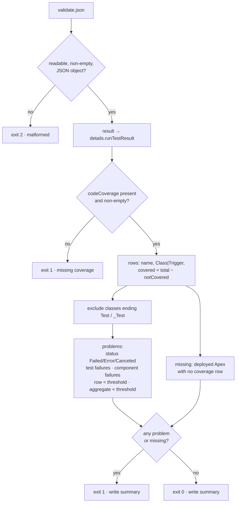
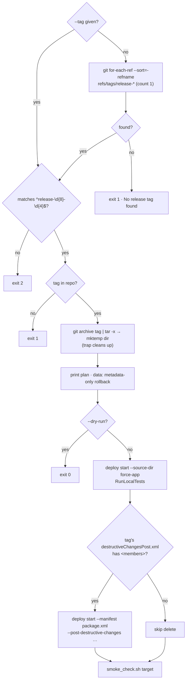

# Technical Design

This document covers the implementation of the Salesforce DevOps Pipeline: file by file, decision by decision, and exit code by exit code. For the layered picture, see [ARCHITECTURE.md](ARCHITECTURE.md).

> Every behaviour described here comes from the code in this repository and its local tests (83 Python, 8 Node). Org-side results such as test outcomes in an org, quick-deploy refusals, and Bulk API responses are documented expectations, not recorded runs.

**Contents:** [1 Repository layout](#1-repository-layout) · [2 Scratch org design](#2-scratch-org-design) · [3 Coverage gate](#3-coverage-gate) · [4 Validation workflow](#4-validation-workflow) · [5 Deployment workflow](#5-deployment-workflow) · [6 Rollback process](#6-rollback-process) · [7 Backup process](#7-backup-process) · [8 Triage engine](#8-triage-engine) · [9 Test strategy](#9-test-strategy) · [10 Design decisions](#10-design-decisions)

---

## 1. Repository layout

| Path | Contents | Deployed to Salesforce? |
|---|---|:-:|
| `sfdx-project.json` | Project `sf-devops-pipeline`, package directory `force-app`, API `68.0`, no namespace, `login.salesforce.com` | — |
| `config/project-scratch-def.json` | Developer scratch definition | — |
| `force-app/main/default/` | `objects/Release_Checklist_Item__c` (+4 fields) · `classes/` (service + test) · `triggers/` · `flows/` · `lwc/checklistItemBadge` · `permissionsets/` | **Yes** |
| `manifest/package.xml` | 7 members across 6 metadata types, API 68.0 | Used by destructive rollback |
| `manifest/destructiveChangesPost.xml` | Empty delete list (no `<members>`) | Used by rollback when populated |
| `.github/workflows/` | `pr-validate.yml`, `deploy-staging.yml`, `deploy-prod.yml` | — |
| `scripts/*.py` | `coverage_gate.py`, `parse_job_id.py`, `quick_deploy_decision.py`, `release_tag.py`, `data_ops.py` | — |
| `scripts/*.sh` | `production_deploy.sh`, `smoke_check.sh`, `rollback.sh`, `seed.sh`, `bulk-load.sh`, `backup.sh`, `restore-plan.sh` | — |
| `triage/` | `triage.py`, `rules.yml`, `eval/` (15 fixtures + `manifest.json`) | — |
| `backup-queries/` | 3 committed SOQL files | — |
| `data/seed/`, `data/bulk/` | Synthetic CSVs | — |
| `backups/`, `reports/` | Runtime output. Gitignored except each folder's README. | — |
| `docs/`, `runbooks/` | 19 runbooks and references | Excluded by `.forceignore` |
| `tests/` | 4 Python suites, 1 Node suite, `fixtures/` (7 validate JSONs) | Excluded by `.forceignore` |

**Line-ending policy.** `.gitattributes` forces LF on `*.sh`, `*.py`, `*.yml`, `*.soql`, and `*.csv`. The scripts must run on Linux runners and in WSL even when they're edited on Windows.

**Ignore policy.** `.gitignore` covers CLI auth and tracking state (`.sf/`, `.sfdx/`), test output, every runtime report under `reports/`, and every dated backup folder. Only `backups/README.md` and `reports/README.md` are tracked in those folders.

## 2. Scratch org design

### Definition

```json
{
  "orgName": "SF DevOps Pipeline Scratch",
  "edition": "Developer",
  "hasSampleData": false,
  "features": ["EnableSetPasswordInApi"],
  "settings": {
    "lightningExperienceSettings": { "enableS1DesktopEnabled": true },
    "mobileSettings": { "enableS1EncryptedStoragePref2": false }
  }
}
```

| Choice | Reason |
|---|---|
| `edition: Developer` | Matches the Dev Hub's edition and allocation. No paid edition features are assumed. |
| `hasSampleData: false` | Tests see only the rows they insert, and the scratch org starts empty |
| `EnableSetPasswordInApi` | Lets an operator set a password through the API for a scratch user when needed |
| Lightning Experience on, persistent browser caching off | A predictable admin UI for the Setup change in the source-tracking demo |

### Lifecycle

| Stage | Command | Expected effect |
|---|---|---|
| Quota check | `sf limits api display --target-org devhub-org-a` | `ActiveScratchOrgs` (max 3) and `DailyScratchOrgs` (max 6 per rolling 24 hours) each have at least 1 remaining |
| Create | `sf org create scratch --definition-file config/project-scratch-def.json --alias m1-scratch --duration-days 7 --set-default --target-dev-hub devhub-org-a` | Org created with tracking on, because `--no-track-source` isn't passed |
| Deploy | `sf project deploy start --source-dir force-app --target-org m1-scratch --wait 10` + `sf org assign permset --name Release_Checklist_Access` | Components listed in the runbook succeed |
| Track | `sf project retrieve preview` → `retrieve start` | The demo field `Needs_Follow_Up__c` is written to `force-app/` |
| Test | `sf apex run test --test-level RunLocalTests --code-coverage …` | Documented expectation: 7 tests pass and the service and trigger reach 100% |
| Delete | `sf org delete scratch --target-org m1-scratch --no-prompt` | The active slot returns. The daily create doesn't. |

**Recovery procedures** in `docs/RUNBOOK.md` are R1 re-authenticate, R2 free an active slot, R3 wait out the daily window, R4 replace an expired org, R5 resolve a tracking conflict (preview first, then `--ignore-conflicts` in the chosen direction), R6 fix a failed deploy, R7 fix a failed test, and R8 repository check failed.

### Sample application contract

| Rule | Enforced by |
|---|---|
| A blank `Status__c` becomes `Draft` and a blank `Sequence__c` becomes `100`, on insert and update | `ReleaseChecklistItemService.applyDefaults`, called from a `before insert, before update` trigger |
| Null list, empty list, and null element are no-ops | Guard clauses in the service, plus a dedicated test |
| `Ready_For_Review__c` mirrors `Status__c = Ready` | The `Stamp_Ready_For_Review` record-triggered before-save flow (Active) |
| `Status__c` accepts only Draft, Ready, and Complete | A restricted picklist, which is why the bulk sample's `NotAStatus` row fails |
| Bulk-safe | A test inserts 200 records in one transaction |
| The service respects sharing | `public with sharing`. The service doesn't query today, and the keyword keeps future queries in user context. |

## 3. Coverage gate

`scripts/coverage_gate.py`, about 430 lines, Python standard library only.



| Detail | Implementation |
|---|---|
| Thresholds | `Decimal("85")` for classes and for triggers. Can be overridden with `--class-threshold` and `--trigger-threshold`. |
| Percent | `Decimal(covered) * 100 / Decimal(total)`, `quantize(0.01, ROUND_HALF_UP)`. A zero-location row counts as 100%. |
| Type mapping | `Class` and `ApexClass` → Class. `Trigger` and `ApexTrigger` → Trigger. Any other type is an error. |
| Integrity checks | `numLocations` and `numLocationsNotCovered` must be non-boolean integers with `0 ≤ notCovered ≤ total` |
| Missing-row detection | Every non-test class or trigger named in `result.files` or `details.componentSuccesses` must have a coverage row |
| Validation problems | `success: false`, a status of `Failed`, `Error`, `Canceled`, or `Cancelled`, each `runTestResult.failures` entry, `numFailures > 0`, and each `componentFailures` entry |
| Aggregate | Class and trigger totals are added as problems only when no per-row problem already names that type |
| Output | `reports/coverage-summary.md`: outcome, thresholds, tests run, failures, `checkOnly`, a per-row table, aggregates, missing entries, and problems. On malformed input a short failure summary is still written. |
| Exit codes | `0` pass · `1` gate failed · `2` input unusable |

**Fixture results** (run locally): pass → 0 · exact 85.00% → 0 · low coverage (80.00% class, 25.00% trigger) → 1 · missing entry → 1 · empty coverage → 1 · test failure → 1 · malformed → 2.

## 4. Validation workflow

`.github/workflows/pr-validate.yml`. Trigger: `pull_request`. Permissions: `contents: read`.

| # | Step | Command and behaviour |
|:-:|---|---|
| 1 | Checkout | `actions/checkout@v4` |
| 2 | Java Setup | `actions/setup-java@v4`, Temurin 17. PMD inside Code Analyzer needs Java 11 or later. |
| 3 | Node Setup | `actions/setup-node@v4`, Node 20 |
| 4 | Salesforce CLI | `npm install --global @salesforce/cli@latest` |
| 5 | Code Analyzer | `sf plugins install code-analyzer@latest` · `sf code-analyzer run --workspace force-app --rule-selector Recommended --severity-threshold 2 --output-file reports/code-analyzer.html` |
| 6 | Org Login | Fails clearly if `STAGING_AUTH_URL` is empty. `umask 077` · write to `$RUNNER_TEMP` · `sf org login sfdx-url --alias staging --set-default` · delete the file · `sf org display` |
| 7 | Deploy Validation | `sf project deploy validate --source-dir force-app --target-org staging --test-level RunLocalTests --wait 30 --json > reports/validate.json` |
| 8 | Coverage Gate | `if: always() && hashFiles('reports/validate.json') != ''` → `python3 scripts/coverage_gate.py reports/validate.json --summary reports/coverage-summary.md` |
| 9 | Artifact Upload | `if: always()` · `pr-validation` · 14 days · `if-no-files-found: warn` |

**Ordering rationale.** Static analysis runs before login, so a Critical finding costs no Org B API calls. The coverage gate runs even after a failed validation, so the summary always explains the failure. Upload uses `warn`, so a missing file never hides the original error.

**Documented negative outcomes** (`docs/pr_validation.md`): a failing Apex test fails Deploy Validation and the gate. Coverage of 80% or 25% fails only the gate, because Org B accepts it. A severity-1 finding stops the job at Code Analyzer.

## 5. Deployment workflow

### Staging: `deploy-staging.yml`

Trigger: `push` to `main`. Permissions: `contents: read`. Concurrency group `deploy-staging`, `cancel-in-progress: false`.

Steps: checkout → Node 20 → CLI → login as `staging` (same secret handling as above) → `sf project deploy start --source-dir force-app --target-org staging --test-level RunLocalTests --wait 30` → `bash scripts/smoke_check.sh staging`.

### Production stand-in: `deploy-prod.yml`

Trigger: `workflow_dispatch` with required string input `confirm`. Permissions: `contents: write`, needed to push the tag. Concurrency group `deploy-prod`, `cancel-in-progress: false`. Checkout uses `fetch-depth: 0` so existing tags are visible.

| # | Step | Behaviour |
|:-:|---|---|
| 1 | Release Approval | `CONFIRM != "deploy"` → exit 1 before any org contact |
| 2 | Org Login | `PROD_AUTH_URL` → alias `prod` |
| 3 | Validate | `sf project deploy validate … --target-org prod --test-level RunLocalTests --json > reports/validate.json`. A non-zero exit stops the job with "Quick deploy was not started." Then the coverage gate runs. |
| 4 | Capture Job ID | `parse_job_id.py` → `reports/job-id.txt` |
| 5 | Quick Deploy | `bash scripts/production_deploy.sh` |
| 6 | Smoke Check | `bash scripts/smoke_check.sh prod` |
| 7 | Release Tag | `release_tag.py` → refuse if `refs/tags/<tag>` exists → annotated tag by `github-actions[bot]` → push |
| 8 | Artifact Upload | `if: always()` · `production-release` · 14 days: `validate.json`, `quick-deploy.json`, `coverage-summary.md`, `job-id.txt`, `fallback-deploy.json` |

### `parse_job_id.py`

| Input | Result |
|---|---|
| Not an object, unreadable, empty, or invalid JSON | exit 2 |
| `result` missing | exit 1, "Quick deploy was not started." |
| `success: false` or status in {Failed, Error, Canceled, Cancelled} | exit 1, "Validation did not succeed (status=…)" |
| Neither `success: true` nor `status: Succeeded` | exit 1 |
| `result.id` doesn't match `^0Af[a-zA-Z0-9]{12}(?:[a-zA-Z0-9]{3})?$` | exit 1, "not a deploy request id (0Af...)" |
| Otherwise | Prints the ID, exit 0 |

### `production_deploy.sh` and `quick_deploy_decision.py`

```text
JOB_ID = parse_job_id.py reports/validate.json
sf project deploy quick --job-id $JOB_ID --target-org prod --wait 30 --json
      > reports/quick-deploy-cli.json  2> reports/quick-deploy.stderr
outcome = quick_deploy_decision.py assess --exit-code … --stdout-file … --stderr-file …
  succeeded   → write record, exit 0
  unsupported → sf project deploy start … --test-level RunLocalTests --json > reports/fallback-deploy.json
                write record (reason includes CLI text, truncated at 500 chars), exit with the fallback's code
  failed      → write record, "A normal deploy was not started.", exit 1
```

`assess` returns `unsupported` only when the lower-cased stdout and stderr contain one of 9 markers, for example "only supported in production", "quick deployments are only supported", "not eligible for quick deploy", or "the org is not a production org". It returns `failed` for everything else, including `INVALID_SESSION_ID`. Checked locally: a "Quick deployments are only supported in production orgs." message → `unsupported`, and `INVALID_SESSION_ID` → `failed`.

`reports/quick-deploy.json` fields: `validationJobId`, `quickDeployAttempted`, `quickDeploySupported`, `fallbackUsed`, `outcome`, `reason`, `command`, `cli`, `fallback`. `--dry-run` prints the four planned lines without calling Salesforce.

### `smoke_check.sh <alias>`

1. `sf sobject describe --sobject Release_Checklist_Item__c`
2. `sf org list metadata --metadata-type PermissionSet` contains `Release_Checklist_Access`
3. `LightningComponentBundle` contains `checklistItemBadge`
4. `Flow` contains `Stamp_Ready_For_Review`
5. `sf apex run test --test-level RunLocalTests --wait 20`

Any miss prints `SMOKE FAIL: …` and exits 1. `--list` prints the five checks offline.

### `release_tag.py`

`release-%Y%m%d-%H%M` in UTC. `--at` accepts ISO-8601 with `Z` or an offset. A naive datetime → exit 2, "Release tag time must be timezone-aware. Use UTC." For example, `--at 2026-11-09T12:40:00Z` → `release-20261109-1240`.

## 6. Rollback process

`scripts/rollback.sh [--tag release-YYYYMMDD-HHMM] [--target-org prod] [--repo-root PATH] [--dry-run]`



Design points:

- **The tag's own delete list is used,** not the current branch's. A release that should remove a later component lists it in that release's destructive manifest.
- **`git archive`, not `git checkout`.** The operator's working tree and branch are never changed.
- **Lexicographic sort is time order** because tags are zero-padded.
- **Verified locally:** with a demo tag, `--dry-run` prints `rollback-tag`, `checkout`, `deploy`, `data`, `destructive: skip`, and `smoke`, then exits 0. With no tag it exits 1. With `--tag v1.0` it exits 2.

## 7. Backup process

`scripts/backup.sh [--target-org staging] [--date YYYYMMDD] [--force] [--dry-run]`, backed by `scripts/data_ops.py`.

| Step | Detail |
|---|---|
| Directory | `backups/<UTC YYYYMMDD>/`. `prepare-backup-dir` exits 1 if it already holds files and `--force` isn't set. |
| Queries | `backup-queries/Release_Checklist_Item.soql` (Id, Name, Status, Sequence, Details, Ready flag, OwnerId, Created and LastModified dates), `User.soql` (active users), `PermissionSetAssignment.soql` (`PermissionSet.IsOwnedByProfile = false`) |
| Exports | For each query, `sf data query --file … --result-format csv` and `--json`, giving 6 files |
| Catalog | `backup-manifest.json`: `date`, `targetOrg`, `createdAt` (`YYYY-MM-DDTHH:MM:SSZ`), `syntheticDataOnly: true`, `orgClass: "Developer Edition"`, `formats`, and an `objects[]` entry with `name`, `sobject`, `queryFile`, `csv`, `json`, `rowCount` (CSV data rows, header excluded) |
| Retention | Operator routine: keep 7 daily folders locally and never commit them |
| Large objects | If `sf data query` reports too many rows, rerun that object with `sf data export bulk` under the same file name |

### Restore plan

`scripts/restore-plan.sh [--backup backups/YYYYMMDD] [--target-org ALIAS] [--apply]`

| Rule | Implementation |
|---|---|
| Plan by default | Prints the restore order, object dependencies, recovery constraints, and Developer Edition limitations. No Salesforce call. |
| Explicit apply | `--apply` without both `--backup` and `--target-org` → exit 2. A missing `Release_Checklist_Item.csv` → exit 1. |
| Column shaping | `data_ops.py restore-csv` drops `SYSTEM_COLUMNS` (`Id`, `OwnerId`, `CreatedDate`, `LastModifiedDate`, `CreatedById`, `LastModifiedById`, `SystemModstamp`, `IsDeleted`, …), any dotted relationship column, and any `__r` column. It requires `Name` and skips blank rows. |
| Import | `sf data import bulk --sobject Release_Checklist_Item__c --file <stripped> --line-ending LF` |
| Never restored | Users and permission set assignments |
| Known risk | A second `--apply` inserts duplicates |

### Seed and bulk load (related)

- `seed.sh`: checklist bulk import → verify `COUNT() WHERE Name LIKE 'Seed:%' ≥ 3` → `UserLicense` check (`UsedLicenses < TotalLicenses`) → Standard User profile ID (must start `00e`) → user CSV rewritten to `synthetic.seed.<alias>@example.com` → import → `PermissionSetAssignment` record (`DUPLICATE_VALUE` is treated as already present). It warns when the target is `prod` or `devhub-org-a`. `--skip-checklist` reruns the user steps only.
- `bulk-load.sh`: a local `classify` against the picklist values (Draft, Ready, Complete) writes `bulk-success.csv` and `bulk-errors.csv` → `--preflight` stops there → otherwise `sf data import bulk`, then replaces both files with the Bulk API `successfulResults` and `failedResults` for the job (API version read from `sfdx-project.json`). Verified locally: preflight produces 1 error row, `NotAStatus`.

## 8. Triage engine

`triage/triage.py` (about 1,160 lines) and `triage/rules.yml`, Python standard library only.

### Pipeline

| Stage | Function | Behaviour |
|---|---|---|
| Load rules | `load_rules()` | Built-in YAML-subset parser (`_parse_yaml_subset`). Compiles literal and `regex:` patterns per category. |
| Load input | `load_document()` | Keeps the raw text, plus parsed JSON when possible |
| Signals | `collect_signals()` | `_coverage_stage` (coverage rows, excluding `Test` and `_Test`, 85% thresholds), `_analyzer_stage` (violations with severity 1 or 2), `_apex_stage` (failures or `numFailures`), `_pattern_stage` (text patterns per category) |
| Merge | `classify_documents()` | Several files can be passed. A specific structured signal beats a text-only one for the same category. |
| Select | `_select()` | The first category in `priority` that has a signal wins. Otherwise Unknown. Coverage is never the category when tests failed. |
| Explain | `explain()` | Fixed template per category. The `model_configured` argument is accepted and ignored. |
| Guard | `_redact()` and the post-check | Removes `sf project deploy start`, `sf project deploy quick`, and `git merge`. Raises `TriageError` if any remain. |
| Render | `render_report()` | Markdown report plus the suggested PR comment |

### Output fields

`Failure Category`, `Confidence` (value and label), `Likely Cause`, `Suggested Next Step`, `Reference Artifact` (file plus a section such as `#result.details.runTestResult.codeCoverage[ReleaseChecklistItemService]`), `Human review required.`, `Suggested PR comment`, `explanation`, and `explanation_source` ("This explanation is rule-based, not a live model call.").

### Confidence

| Category | Value | Label |
|---|:-:|:-:|
| Authentication Failure | 0.97 | high |
| Apex Test Failure | 0.95 | high |
| Permission Problem | 0.94 | high |
| Code Analyzer Violation | 0.93 | high |
| Coverage Failure | 0.92 | high |
| Metadata Conflict | 0.90 | high |
| Missing Component | 0.88 | high |
| Unknown | 0.34 | low |

Label bands: high ≥ 0.80, medium 0.50 to 0.79, low < 0.50. Values are fixed per category in `rules.yml`. They're not learned probabilities.

### Evaluation

`evaluate_fixtures()` reads `triage/eval/manifest.json` and classifies each case with the same `classify_path` used by the CLI. It reports `cases_evaluated`, `correct_classifications`, `incorrect_classifications`, `unknown_classifications`, and `accuracy`. The current result is 15, 15, 0, 2, 1.0. The fixture set deliberately includes precedence cases (auth over test noise, permission over coverage, a test failure together with low coverage) and two true negatives (a disk-space message, and a severity-3 finding only).

### CLI

`python triage/triage.py <report> [<report> …] [--rules path]` prints a report and exits 0. `--eval` prints the metrics as JSON. A `TriageError` exits 2.

## 9. Test strategy

| Suite | Tests | What it proves |
|---|:-:|---|
| `tests/test_triage.py` | 23 | Each category, precedence rules, the Unknown fallback, exact-85% and just-under cases, required report fields, no deploy or merge commands in output, a template that stays rule-based even with a model flag set, engine source that doesn't shell out or call a model, the eval score, and docs headings |
| `tests/test_coverage_gate.py` | 11 | Pass, exact 85%, below 85%, missing entries, empty list, absent key, malformed JSON, a JSON array, a failed Apex test, the PR workflow staying check-only, and the PR doc's required sections |
| `tests/test_deployment.py` | 23 | Tag format, job-ID parsing, quick-deploy decisions, rollback dry runs against temporary git repos with tags, and runbook headings |
| `tests/test_data_operations.py` | 26 | Seed and bulk CSV rules, the manifest, restore shaping, Bash syntax checks (`bash -n`), script dry runs, and the data runbook |
| `tests/m1-foundation.test.js` | 8 | The scratch definition, project structure, metadata XML well-formedness and API 68.0, the Apex contract (7 test methods, no `SeeAllData`), runbook and docs headings, and a "stop line" that allows only the three workflows and forbids product-integration paths |

Run them with:

```bash
python -m unittest tests.test_triage tests.test_coverage_gate tests.test_deployment tests.test_data_operations
node --test tests/m1-foundation.test.js
```

**Portability note.** Node test 4 validates the XML by calling `powershell`, so it passes on Windows. On macOS and Linux it fails with `spawnSync powershell ENOENT`. When an XML-parsing stand-in for `powershell` is on the `PATH`, all 8 tests pass, which confirms the metadata is well formed. The Python helpers convert paths when Bash is WSL (`bash_path`), so the suite runs from Windows as well.

**The suites never call Salesforce.** A green local run proves the files, gates, and decision logic agree. It doesn't prove that Org B accepts the metadata.

## 10. Design decisions

| Decision | Alternative considered | Rationale |
|---|---|---|
| A custom 85% gate, not the platform's 75% | Rely on Salesforce | Developer Edition doesn't enforce 75% on validation, and per-row 85% catches one weak class hidden in a good average |
| Check-only validation on PRs | Deploy to a scratch org per PR | It costs no scratch quota (3 active, 6 daily) and uses a long-lived org shaped like the release target |
| Quick deploy plus a *narrow* fallback | Always deploy normally | Keeps the production-shaped path and records the edition limitation. A broad fallback would hide real failures. |
| Typed `deploy` approval on `workflow_dispatch` | GitHub Environments with reviewers | Works on any plan with no extra setup. Environments are listed in the roadmap. |
| Tags only after smoke | Tag on deploy | A tag means "known-good", which makes it a safe rollback target |
| `git archive` rollback | `git checkout` | Leaves the operator's working tree untouched |
| Data restore separate from rollback | One "undo" command | Metadata and records have different recovery properties. Combining them would over-promise. |
| Rules plus templates for triage | Call a language model | Deterministic, testable, offline, and free of data egress. A model is optional future work behind the same human gate. |
| Standard library only | PyYAML and other packages | Zero install friction on runners and laptops |
